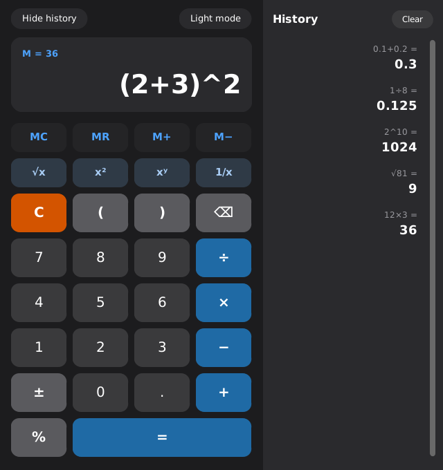
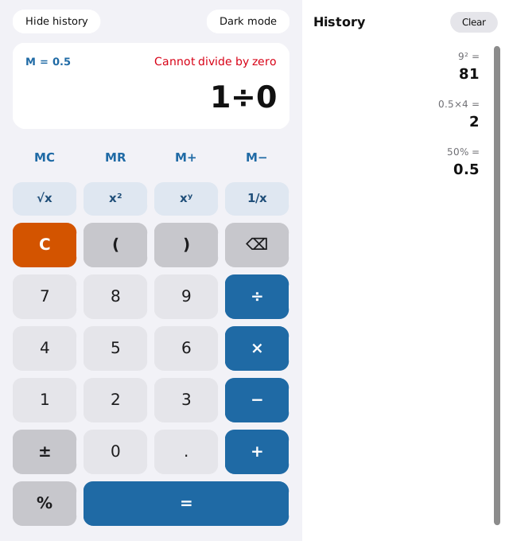

# Calculator Pro

A modern, secure desktop calculator built with **Python and CustomTkinter**.
It has a calculation history, memory keys, scientific functions and
light/dark mode, all powered by a **safe expression parser** (no `eval`) with
accurate decimal math and unit tests.

| Dark mode | Light mode |
|:---:|:---:|
|  |  |

> Want a lightweight version with no dependencies? See
> **[Python Calculator](https://github.com/rizky-916/python-calculator)**.

## Features

| | |
|---|---|
| **Basic math** | `+ − × ÷`, percent, parentheses, implicit multiplication (`2(3)`, `2√9`) |
| **Scientific** | `√x`, `x²`, `xʸ` (power), `1/x`, `±` (change sign) |
| **History panel** | Last 50 calculations; click one to reuse its result; can be hidden |
| **Memory** | `MC`, `MR`, `M+`, `M−`, with the stored value shown on the display |
| **Copy result** | `Ctrl+C` (`⌘C` on macOS) copies the result to the clipboard |
| **Accurate decimals** | `0.1 + 0.2 = 0.3` (uses Python's `decimal` module) |
| **Friendly errors** | e.g. *Cannot divide by zero*, *Invalid input for √*, *Number too large* |
| **Themes** | Light and dark mode; every color adapts |
| **Keyboard** | Type numbers and operators, `Enter` = calculate, `Backspace`, `Esc` |

## Security

Many beginner calculators compute results with `eval()`, which runs **any**
Python code typed into the display (for example `__import__('os').system(...)`).
Calculator Pro does not do that:

- **No `eval`/`exec`.** Input is tokenized and parsed by a small recursive-descent
  parser that only accepts digits, a decimal point and the calculator's own
  operators. Everything else is rejected.
- **No freezing.** Expression length (200 characters) and nesting depth
  (50 levels) are limited. Results are capped at 10^10000, so input like
  `9^9^9` returns *Number too large* instantly instead of hanging the app.
- **Validated input everywhere.** Keyboard keys, history items and memory recall
  all go through the same validation as the buttons. The display is not a free-text field.
- **Privacy.** History and memory live only in RAM. Nothing is written to
  disk, and there is no network access.

These protections are covered by unit tests in [`tests/test_engine.py`](tests/test_engine.py).

## Requirements

- Python 3.9 or newer, with Tkinter
  - Windows/macOS: included with the installer from [python.org](https://www.python.org/downloads/)
  - Debian/Ubuntu: `sudo apt install python3-tk`
- [CustomTkinter](https://github.com/TomSchimansky/CustomTkinter) (installed from `requirements.txt`)

## Getting started

```bash
# 1. Clone the repository
git clone https://github.com/rizky-916/calculator-pro.git
cd calculator-pro

# 2. (Recommended) create a virtual environment
python -m venv .venv
# Windows:      .venv\Scripts\activate
# macOS/Linux:  source .venv/bin/activate

# 3. Install dependencies
pip install -r requirements.txt

# 4. Run
python main.py
```

## How to use

| Action | Buttons / keys | Example |
|---|---|---|
| Power | `xʸ` or `^` | `2 ^ 10` → `1024` |
| Square | `x²` | `9 x²` → `81` |
| Square root | `√x` (applies to the number or bracket after it) | `√ ( 9 + 16 )` → `5` |
| Reciprocal | `1/x` (applies to the whole expression) | `4 1/x` → `0.25` |
| Change sign | `±` (toggles the last number) | `3 + 5 ±` → `3+(-5` → `-2` |
| Percent | `%` | `200 × 10 %` → `20` |
| Memory | `M+` / `M−` add/subtract the current value, `MR` inserts it, `MC` clears it | |
| Reuse a result | click an item in the **History** panel | |
| Copy | `Ctrl+C` / `⌘C` | |
| Calculate | `=` or `Enter` | |
| Delete / clear | `⌫` or `Backspace` / `C` or `Esc` | |

## Running the tests

```bash
python -m unittest discover -s tests -v
```

The tests cover only the engine, so they run without a display or CustomTkinter.

## Project structure

```
.
├── calculator_pro/
│   ├── __init__.py
│   ├── engine.py        # safe parser/evaluator, memory, history (no GUI code)
│   └── ui_common.py     # button layout, keyboard mapping, font helpers
├── tests/
│   └── test_engine.py   # math, error, security and input tests
├── docs/screenshots/
├── main.py              # CustomTkinter user interface (entry point)
├── requirements.txt
└── LICENSE
```

## Author

**Rizky Maulana Hafis**, GitHub: [@rizky-916](https://github.com/rizky-916)

## License

Released under the [MIT License](LICENSE).
